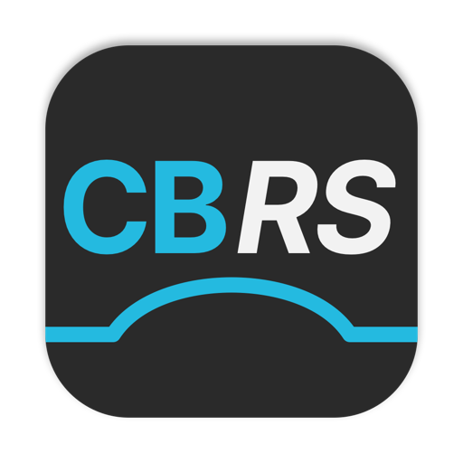
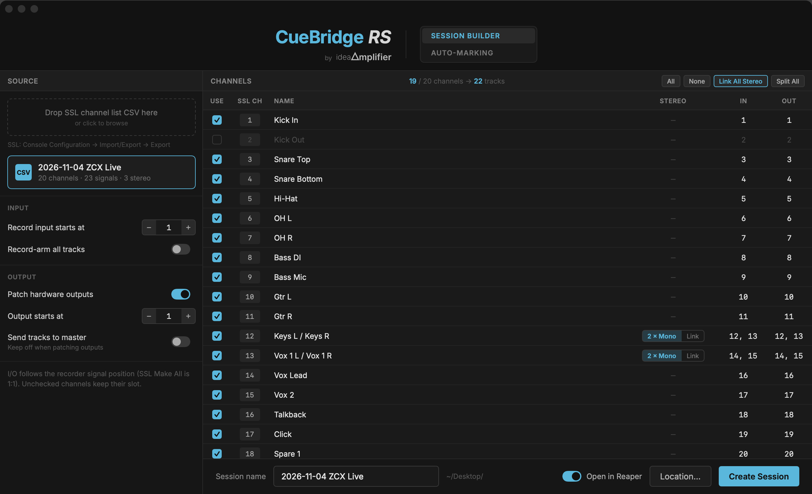
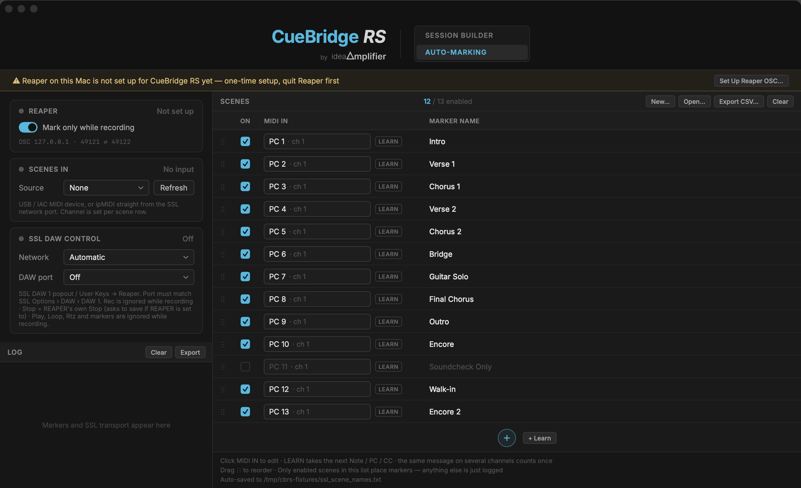

  

<h1 align="center">CueBridge RS</h1>

<b>SSL Live ↔ REAPER, for live multitrack recording.</b> 
Every console scene becomes a named marker. The console's own transport drives REAPER. 
One network cable, no ipMIDI driver, no counting scenes by hand.

  
  
  

> **For** live sound engineers who record a multitrack from an SSL Live console into REAPER — and want the console's scenes, transport and channel list to line up with the DAW.

**[⬇ Download for macOS](https://github.com/IdeaAmplifierlifier/CueBridge-RS/releases/latest)** · [Manual (PDF)](#documentation) · [中文說明](#中文說明)

---

## What it does

| | |
|---|---|
| **SESSION BUILDER** | Turn the SSL channel list into a REAPER project: tracks named and ordered like the console, record inputs and hardware outputs patched in recorder order, stereo channels split to 2 × mono or linked. |
| **AUTO-MARKING** | Every SSL scene fires a MIDI message; CueBridge drops a named marker in REAPER while it records — no clicking, no counting. |
| **SSL DAW CONTROL** | The console's own DAW transport (DAW 1 popout, User Keys, Events) drives REAPER over ipMIDI (HUI): Rec / Stop / Play / Loop / Rtz / Prev / Next / Goto Marker 1. REAPER's state lights the buttons on the console. |

## Requirements

- **macOS 13 (Ventura) or later** — Apple Silicon and Intel
- **REAPER**
- **SSL Live V5.2 or later**
- One Ethernet cable from the Mac to the SSL **Connectivity port**, on a subnet that is **not** shared with Dante
- No ipMIDI driver, no third-party libraries

## Install

1. Download the latest `.pkg` from [Releases](https://github.com/IdeaAmplifierlifier/CueBridge-RS/releases/latest).
2. Open it and follow the installer.
3. If macOS says the developer cannot be verified: **right-click the app → Open**, or allow it in **System Settings → Privacy & Security**.

## Five-minute setup

**On the SSL**

- **Options › Network** — Connectivity port on a non-Dante subnet; Mac on the same subnet.
- **Options › DAW** — **DAW 1 = HUI** on an ipMIDI port (e.g. 2). Tick **Transport Master** if User Keys should drive the transport.
- **Scene Output Action** — make the MIDI action to the local MIDI port **and** an ipMIDI port (e.g. 1). Use a different ipMIDI port for DAW Control.

**In REAPER (once per Mac)**

- Quit REAPER → open CueBridge → **AUTO-MARKING** → **Set Up Reaper OSC…**
- This adds one OSC control surface (`CueBridge_RS`) and a lean OSC pattern. `reaper.ini` is backed up first. Nothing else is changed.

**In CueBridge**

- `SCENES IN` — the ipMIDI port used for scene messages.
- `SSL DAW CONTROL` — the network card connected to the console, and the same ipMIDI port as SSL **DAW 1**.

The first console heard is locked in; after changing venue, press **Re-detect**.

## Documentation

- **[使用說明書（PDF）](docs/manual-zh.pdf)** — setup, SESSION BUILDER, AUTO-MARKING, transport, troubleshooting, checklist
- **[使用說明書（Markdown）](docs/manual-zh.md)**

## Known limitations

- Only the first console sending HUI is listened to; other ipMIDI senders are ignored.
- `reaper.ini` is only supported at its standard location (no REAPER portable install).
- No auto-update — install new versions manually.
- SESSION BUILDER assumes SSL recorder I/O follows the Console Config order 1:1 (SSL Live V5.2+ Make All).
- Scene MIDI actions must be configured on the console; CueBridge does not change console settings.

## 中文說明

**CueBridge RS** 把 SSL Live 控台與 REAPER 接起來，為現場多軌錄音設計：

- **SESSION BUILDER** — 用 SSL 的 channel list 直接建好 REAPER 專案，軌道名稱、順序、I/O 一次到位
- **AUTO-MARKING** — 每個 scene 觸發時自動在 REAPER 打一個具名 marker
- **SSL DAW CONTROL** — 用控台自己的 Rec／Stop／Play／Loop／Rtz／Prev／Next 控制 REAPER，按鍵燈同步

只需要一條網路線接到 SSL 的 Connectivity 埠，不需要 ipMIDI 驅動。完整設定與疑難排解見 **[使用說明書（PDF）](docs/manual-zh.pdf)**。

## License

**Free to download and use. Source code is not published.** See [LICENSE.md](LICENSE.md).

You may redistribute the unmodified installer. You may not modify and redistribute it under the CueBridge RS name, or sell it.

## Contact

Questions, bug reports, or a show you want to try it on: **agaetiss@gmail.com**

---

CueBridge RS v0.2.8 · macOS 13+ · by <a href="https://github.com/IdeaAmplifier">ideaAmplifier</a>

