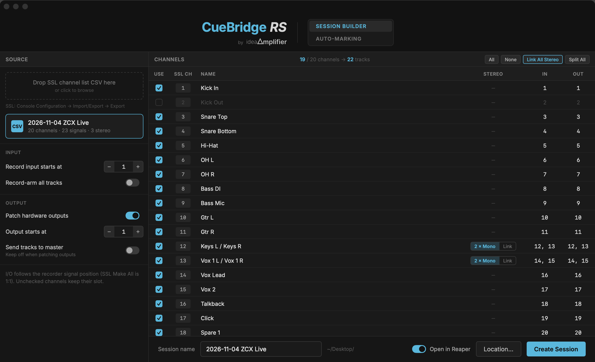
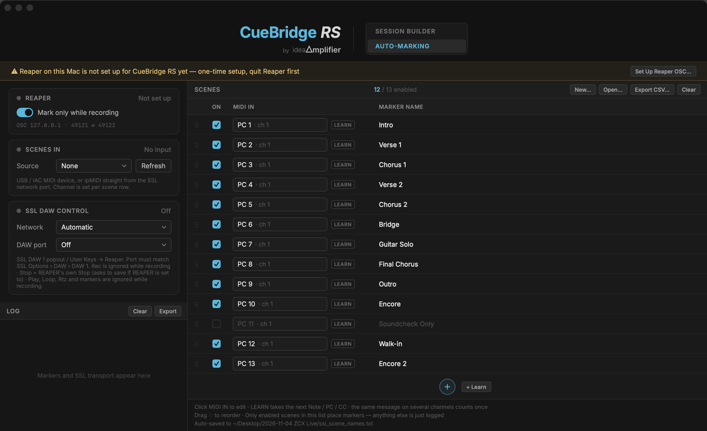

# CueBridge RS 使用說明書

**Connecting between Reaper and SSL Live** · by ideaAmplifier

版本 **v0.2.8** · macOS 13 以上 · 免費

> 本手冊對應 app 內的英文介面；文中以 `等寬字` 標示畫面上實際出現的按鈕與欄位名稱。

---

## 1. 這是什麼

CueBridge RS 是 SSL Live 控台與 REAPER 之間的橋樑，為現場多軌錄音設計。它本身**不處理音訊**，只負責三件事：

| 功能 | 做什麼 |
|---|---|
| **SESSION BUILDER** | 把 SSL 的 channel list（CSV）變成一個新的 REAPER 專案：軌道名稱與順序跟控台一致，錄音輸入與硬體輸出照 recorder 順序接好 |
| **AUTO-MARKING** | SSL 每個 scene 觸發時，在 REAPER 錄音中打一個具名 marker |
| **SSL DAW CONTROL** | 控台自己的 DAW 鍵（DAW 1 popout、User Keys、Events）透過 ipMIDI（HUI）控制 REAPER 的錄音、播放、循環與 marker 跳轉；REAPER 的狀態回送控台按鍵燈 |

**適合**：用 SSL Live 控台做現場多軌錄音、事後要照 scene 對齊混音的人。

**不適合**：不用 SSL Live 的場合；需要自動混音、自動 EQ 的場合（本工具不做任何音訊處理）。

---

## 2. 系統需求

- **macOS 13（Ventura）以上** — 已在 13.7.1 實機驗證
- 通用版：Apple Silicon 與 Intel 皆可（Intel 經 Rosetta 執行）
- **REAPER**
- **SSL Live V5.2 以上**（本工具假設 recorder 的 I/O 是 Console Config 順序的 1:1）
- 網路：一條網路線，Mac ↔ SSL 的 **Connectivity 埠**；此子網**不可與 Dante 同段**
- 不需要安裝 ipMIDI 驅動

---

## 3. 安裝

1. 開啟 `CueBridge-RS-v0.2.8-Mac.pkg`，依指示安裝
2. 從「應用程式」開啟 CueBridge RS
3. 若 macOS 提示「無法驗證開發者」：對 app 按**右鍵 → 打開**，或到「系統設定 → 隱私權與安全性 → 仍要打開」

> 簽名與公證完成後，上述第 3 步不再出現。

---

## 4. 一次設定（五分鐘）

### 4.1 SSL 控台端

1. **Options › Network**
   - Connectivity 埠設在一個**與 Dante 不同**的子網
   - Mac 接在同一子網
2. **Options › DAW**
   - **DAW 1 = HUI**，指定一個 ipMIDI 埠（例：**2**）
   - 若要用 User Keys 控制 transport，勾選 **Transport Master**
3. **Scene Output Action**
   - 每個 scene 的 MIDI 動作同時 Make **本機 MIDI**（例如給 Fourier）**＋ ipMIDI 1**
   - DAW Control 用**另一個** ipMIDI 埠（例：2）
4. 注意事項
   - **DAW channel 沒有音訊**，不要放進 bank
   - Channel View 側欄的 DAW popout 若顯示 DAW 2 且全灰 → **長按**切回 DAW 1

### 4.2 REAPER 端（每台 Mac 一次）

1. **先關閉 REAPER**（REAPER 結束時會重寫 `reaper.ini`）
2. 在 CueBridge 的 **AUTO-MARKING** 頁，按 `Set Up Reaper OSC…` → `Set Up`
3. 重新開啟 REAPER

它做了什麼：

- 在 `reaper.ini` 的 `[reaper]` 區段加入一個 OSC control surface：`CueBridge_RS`
  - REAPER 監聽 **49121**，回覆 **49122**
- 寫入精簡 OSC pattern：`OSC/CueBridge.ReaperOSC`
  - 預設 pattern 會替 surface 每次更新計算軌名、音量、VU、FX 與 6 種時間格式（播放中約 290 則／秒）；精簡版只有約 12 則／秒
  - 這是為了 90 軌全 armed 錄音時，REAPER 不會因為負載漏掉插 marker 的指令
- **備份 `reaper.ini`**：`reaper.ini.before-CueBridgeRS.bak` ＋ 時間戳備份
- 其他設定**完全不動**；不需要在 REAPER 裡設定 MIDI

> 建議：到 REAPER 的 **Preferences → Control/OSC/web** 刪掉沒有在用的 OSC surface。

### 4.3 CueBridge 端

在 **AUTO-MARKING** 頁設定：

| 欄位 | 設定 |
|---|---|
| `SCENES IN` 的 `Source` | `ipMIDI 1 · network`；若走 USB／IAC 實體 MIDI 介面則選該裝置 |
| `SSL DAW CONTROL` 的 `Network` | 接到 SSL 的那張網卡 |
| `SSL DAW CONTROL` 的 `DAW port` | 與 SSL 的 **DAW 1** 相同的 ipMIDI 埠（例：2） |

- 第一個送來 HUI 的控台 IP 會被鎖定，畫面上顯示在 `Console`；網路上其他 ipMIDI 來源一律忽略
- **換場地或控台換 IP 後**，按 `Re-detect` 重新偵測

---

## 5. SESSION BUILDER：演出前建立 REAPER 專案

### 5.1 匯出 SSL channel list

SSL：**Console Configuration → Import/Export → Export**，匯出 CSV。

### 5.2 載入

把 CSV 拖進左欄的 `Drop SSL channel list CSV here`，或點擊瀏覽。

載入後左欄顯示檔名與摘要：`N channels · N signals · N stereo`。

### 5.3 左欄選項

| 選項 | 預設 | 說明 |
|---|---|---|
| `Record input starts at` | 1 | 第一個 recorder 訊號對應的 REAPER 輸入編號 |
| `Record-arm all tracks` | 關 | 建立後是否全部軌道 arm |
| `Patch hardware outputs` | **開** | 是否寫入 REAPER 的硬體輸出 |
| `Output starts at` | 1 | 第一個輸出編號 |
| `Send tracks to master` | **關** | 已 patch outputs 時請保持關閉 |

> **警告會自動出現**：
> - 訊號數 > 64 → 一條 MADI recorder 在 48k 只有 64 聲道，第 65 個訊號以後要檢查 I/O
> - 同時 patch outputs 又送 master → 若 master 走 outputs 1/2，播放時整盤混音會灌進第一軌的錄音回送

### 5.4 右欄軌道表

| 欄位 | 說明 |
|---|---|
| `USE` | 是否建立這條軌道 |
| `SSL CH` | 控台 channel 編號／名稱 |
| `NAME` | 軌道名稱（stereo link 時顯示單一連結名稱） |
| `STEREO` | 只有 stereo 聲道才有：`2 × Mono` 或 `Link` |
| `IN` | 對應的錄音輸入編號 |
| `OUT` | 對應的硬體輸出（未 patch 時顯示 `—`） |

- 表頭右側顯示 `已勾選 / 總數 channels → N tracks`
- 上方按鈕：`All`／`None`／`Link All Stereo`／`Split All`
- **一行 CSV = 一個 recorder 訊號**；stereo 在 CSV 裡本來就佔兩行
- **I/O 跟著 recorder 訊號位置走**：取消勾選某條軌道，它後面的軌道編號不會往前遞補

### 5.5 建立

底部：

- `Session name` — 預設取自 CSV 檔名
- `Location…` — 預設桌面
- `Open in Reaper` — 建立後直接開啟（預設開）
- `Create Session`

建立的檔案：`<Location>/<Session name>/<Session name>.RPP`

- 同名 `.RPP` 已存在 → 跳出對話框（`OK`／`Show in Finder`），**不會覆蓋**
- 建立成功後，AUTO-MARKING 會自動切換到這場的 scene 清單

---

## 6. AUTO-MARKING：演出中打點

### 6.1 三張狀態卡

**REAPER**

| 狀態 | 意思 |
|---|---|
| `Not set up` | 還沒做 4.2 的 OSC 設定 |
| `No response` | 已設定，但 8 秒內沒收到 REAPER 回覆 → 按 `Retry`，或確認 REAPER 是否開著 |
| `Port in use` | 49121 被佔用（常見：另一個 CueBridge 或 OSC 工具也在跑） |
| `Connected · Stopped` / `Connected · Playing` / `Recording` | 正常 |

- `Mark only while recording`（**預設開**）：只在 REAPER 錄音中打點。關閉後，scene 觸發就打點

**SCENES IN**

| 狀態 | 意思 |
|---|---|
| `No input` | 沒選來源 |
| `Listening` | 已選來源，還沒收到訊息 |
| `Receiving` | 正在收（狀態燈會閃） |
| `Disconnected` | 選的來源不見了 → 按 `Refresh` |

**SSL DAW CONTROL**

| 狀態 | 意思 |
|---|---|
| `Off` | `DAW port` = Off |
| `Waiting for console` | 已選埠，還沒收到控台的 HUI |
| `Online` | 正常 |
| `Network error` | 網路介面或埠有問題 |

### 6.2 Scene 清單

清單在這裡定義：**哪些 scene 要打點、打什麼名字**。

| 欄位 | 說明 |
|---|---|
| `ON` | 啟用／停用這一列 |
| `MIDI IN` | 觸發條件。點它開啟編輯框，或用 `LEARN` 抓下一則 MIDI |
| `MARKER NAME` | 寫進 REAPER 的 marker 名稱 |

**MIDI IN 寫法**

| 寫法 | 意思 |
|---|---|
| `21` | Ch 1 的 Program Change 21（SSL 畫面上的 program number，1–128） |
| `21@5` | PC 21，channel 5 |
| `21@any` | PC 21，任何 channel |
| `CC:20=127@1` | CC 20 = 127，channel 1 |
| `CC:20@any` | CC 20，任何值、任何 channel |
| `NOTE:60@1` | Note On 60，channel 1（60 = C3，與 SSL 一致） |
| `NOTEOFF:60@1` | Note Off 60，channel 1 |

**操作**

- 最下方圓形 `+`：新增一列（PC 自動取最大值 +1）
- `+ Learn`：抓下一則 Note／PC／CC 新增一列；等待時按鈕變成 `Waiting for MIDI…`，再按一次取消
- `⋮⋮` 拖曳排序；拖到最下方放置區 = 移到最後
- `New…`：另開一份空白清單（目前清單不動）
- `Open…`：開啟 `.txt` 清單或 `Export CSV…` 產生的 CSV（CSV 會轉存成同資料夾同名 `.txt`，CSV 本身不動）
- `Export CSV…`：匯出 `MIDI In,Name,Enabled`，方便用試算表整理
- `Clear`：清空目前清單（會立刻存檔，不可復原）

**規則**

- **只有清單裡、且啟用的列會打點**；其他一律只記 Log
- 停用的列收到訊息 → Log 顯示 `Skipped · scene disabled`
- 清單外的 PC → Log 顯示 `Skipped · not in scene list`
- 清單外的 Note／CC → 不記
- 同一個 MIDI In 重複出現在多列 → 表頭出現 ⚠，**只採用第一個啟用的列**
- SSL 的 **All Channels** 會把同一則訊息送到 16 個 channel（現場副本間隔約 70–130 ms）：0.5 秒內、尚未出現過的 channel 視為副本，只算一次；同一個 channel 再次出現 = 真的又觸發了一次

**存檔**

- 自動存到 session 旁的 **`ssl_scene_names.txt`**
- 停用的列存成 `# 觸發,名稱`（`#` 開頭是註解，Windows 的 Lua 版讀同一份檔會自動略過）
- PC + ch 1 寫成 `21,名稱`，與舊版／Lua 版相容

### 6.3 打點流程

1. 收到符合的 MIDI
2. 送 REAPER `action 40157`（插入 marker 於目前位置）
3. 等 REAPER 回報 `/lastmarker/number/str` 改變
4. 用 `/lastmarker/name` 把新 marker 改成清單上的名字

- **2 秒內沒收到確認 → 不改名**（避免改到別的 marker）；Log 顯示 `no reply from Reaper`。此 2 秒是改名確認逾時，與 §6.1 的 8 秒連線存活心跳是不同機制
- 左欄 `Log` 依序列出時間、觸發、名稱、狀態；`Clear` 清除、`Export` 匯出 CSV

### 6.4 SSL DAW CONTROL 對照

| SSL 控制 | REAPER 動作 |
|---|---|
| Rec | 開始錄音 |
| Stop | REAPER 自己的 Stop（是否問存檔依 REAPER 偏好設定） |
| Play | 播放 |
| Loop | 循環 |
| Rtz | 回到專案開頭 |
| Prev／Next | 跳到上一個／下一個 marker |
| Goto Marker 1 | 跳到第 1 個 marker |

**防誤觸**（REAPER 的 `/record`、`/play`、`/repeat` 是切換指令）：

- 錄音中 → `Rec` 忽略
- 錄音中 → `Play`、`Loop`、`Rtz`、marker 跳轉忽略
- `Stop` 一定有效

**Prev／Next** 是 SSL 自己計數，經 HUI 數字鍵（`. N .`）送出 → REAPER `/marker N`。

REAPER 的播放／錄音／循環狀態會回送控台，點亮 DAW 面板上的按鍵燈。

---

## 7. 演出流程檢查表

**進場**

- [ ] Mac 用**有線網路**接到 SSL Connectivity 埠（ipMIDI 走 Wi-Fi 會掉包，觀眾進場後更嚴重）
- [ ] SSL 的 DAW popout 顯示的是 **DAW 1**
- [ ] CueBridge：`SSL DAW CONTROL` 選對網卡與 DAW 埠，狀態 `Online`
- [ ] `SCENES IN` 狀態 `Listening`（按一個 scene 測試是否 `Receiving`）
- [ ] 換過場地 → 按 `Re-detect`

**排練**

- [ ] SESSION BUILDER 建立專案，確認軌數與 I/O 正確
- [ ] Scene 清單已開好、名稱正確
- [ ] 試打 2–3 個 scene，確認 marker 有出現、名字正確
- [ ] 確認 `Mark only while recording` 的開關符合你的工作方式

**演出中**

- [ ] `Log` 頁開著；出現 `Skipped · not in scene list` 表示清單漏了 scene
- [ ] 若出現 `no reply from Reaper`，先確認 REAPER 沒有跳出對話框

**收工**

- [ ] `Export` 匯出 Log CSV，留檔對照

---

## 8. 疑難排解

| 症狀 | 可能原因 | 處理 |
|---|---|---|
| REAPER 一直 `No response` | REAPER 沒開、或 OSC surface 被刪、或 49121 被佔用 | 確認 REAPER 開著；重跑 `Set Up Reaper OSC…`；檢查是否有另一個 OSC 工具 |
| `Port in use` | 另一個 CueBridge 實例或 OSC 程式佔用 49121 | 關掉重複的程式 |
| `Waiting for console` 一直不變 | 網卡選錯、DAW 埠與 SSL 的 DAW 1 不一致、網路不在同一子網 | 核對 4.1／4.3；換網卡後按 `Re-detect` |
| DAW popout 全灰 | 控台正在看 DAW 2（沒設埠） | 長按 DAW popout 切回 DAW 1 |
| Scene 有觸發但沒打點 | 清單外的 scene、列被停用、或 `Mark only while recording` 開著但沒在錄音 | 看 `Log` 的 `Skipped · …` 原因 |
| 同一 scene 打了 16 個點 | 舊版（< 0.2.2）行為；現版已依 channel 去重 | 若仍發生，確認安裝版本 ≥ 0.2.2 |
| 90 軌全 armed 時漏打點 | REAPER 負載太高 | 確認已用精簡 pattern（重跑設定）；刪掉沒用的 OSC surface |
| 換場地後完全沒反應 | console IP 被鎖在上一台 | 按 `Re-detect` |
| 開啟時又跳出設定提示條 | 偵測到舊的 OSC pattern 設定 | 關 REAPER → 重按 `Set Up Reaper OSC…` |
| 畫面上的 `Console` IP 不對 | 網路上有別台送 HUI 的機器 | 只會鎖定第一個來源；確認沒有其他控台／練習程式在送 HUI |
| 安裝時「不允許安裝在此處」 | macOS 版本低於 13 | 確認系統版本 |
| App 被 Gatekeeper 擋下 | 未簽名版本 | 右鍵 → 打開，或系統設定允許 |

**現場除錯工具**：repo 的 `tools/ipmidi-probe.swift` 可抓 ipMIDI／HUI 封包。

---

## 9. 檔案位置

| 檔案 | 位置 |
|---|---|
| OSC pattern | `~/Library/Application Support/REAPER/OSC/CueBridge.ReaperOSC` |
| reaper.ini 備份 | `~/Library/Application Support/REAPER/reaper.ini.before-CueBridgeRS.bak` ＋ 時間戳備份 |
| Scene 清單 | 每個 session 資料夾內的 `ssl_scene_names.txt` |
| Log 匯出 | `Export` 時自選位置 |

> `reaper.ini` 只支援 REAPER 的標準安裝位置；portable install 未支援。

---

## 10. 已知限制

- **只聽第一個送 HUI 的控台**；同網段有其他 ipMIDI 來源會被忽略
- 沒有自動更新；新版本需手動下載安裝
- 不支援 REAPER portable install
- SESSION BUILDER 假設 SSL recorder 的 I/O 是 **Console Config 順序 1:1**（SSL Live V5.2+ 的 Make All）
- Scene 的 MIDI 觸發需在 SSL 的 Scene Output Action 另外設定；CueBridge 不會改控台設定
- 實測環境：macOS 13.7.1（Intel）與 macOS 14（Apple Silicon）；SSL Live（SOLSA L550）＋ REAPER，含 2026-10-04 現場錄音

---

## 11. 授權與致謝

- 本軟體**免費**提供，按現狀提供（as is），不附任何擔保
- 字型：Inter 4.1 © The Inter Project Authors，SIL Open Font License 1.1（授權檔隨 app 附上）

---

*CueBridge RS v0.2.8 · 2026-11 · by ideaAmplifier*
